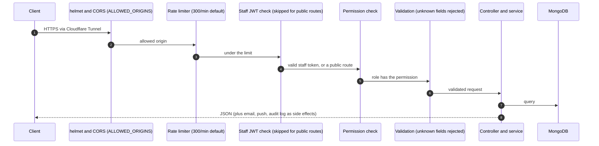

# Backend API

One NestJS application that every app talks to.

- **URL:** `https://api.pawfectpetssherborne.co.uk` (`PUBLIC_API_URL`); health check `GET /health`
- **Code:** `backend/` (NestJS 11 on Express, Mongoose 9, MongoDB 7, Node 22)
- **Version:** `backend/package.json` (not bumped per release; see [Versioning and releases](Versioning-and-Releases))

## How a request is handled

Login routes have tighter limits (for example 10 a minute for staff login, 5 a minute for portal code emails).

## Domain modules

Each lives in `backend/src/<name>/` with a controller, service, module, DTOs and schemas.

| Area | Modules |
| --- | --- |
| People | `customers`, `animals`, `vet-practices`, `enquiries`, `staff`, `roles`, `auth`, `portal` |
| Bookings | `boarding-bookings`, `day-bookings`, `bookings` (legacy), `appointments`, `annual-leave`, `bank-holidays`, `pre-boarding`, `checklists` |
| Money | `invoices`, `quotes`, `payments`, `credit-notes`, `other-income`, `expenses`, `expense-categories`, `vendors`, `bank-accounts`, `bank-transfers`, `payment-methods`, `invoice-terms`, `products`, `reports` |
| Communications | `messages`, `email-messages`, `email-groups`, `push`, `push-messages`, `notifications`, `customer-notifications`, `crm` |
| Compliance | `forms`, `form-submissions`, `risk-assessments`, `policies`, `staff-training` |
| Platform | `settings`, `audit-log`, `recycle-bin`, `common` (encryption, document numbering, client IP, HTML helpers) |

## Route access levels

| Level | Who |
| --- | --- |
| Public | No token: intake, form and pre-boarding links, public invoice and quote links, logins, health, tracking pixels |
| Staff | Any signed-in, unlocked staff member |
| Staff + permission | Staff whose role includes the permission (break-glass and role-less staff always pass) |
| Customer | A customer portal token (`/portal/*` routes) |

## Scheduled jobs

All run inside the backend process, on UK time (`TZ=Europe/London` in the stack).

| Job | How often | What it does |
| --- | --- | --- |
| Appointment reminders | Every 5 min | Push to staff before an appointment, using the configured lead time |
| Checklist reminders | Every 5 min | Push an hour before a checklist's complete-by time if items are unticked |
| Daily digest | Every 5 min (sends once a day) | Staff push summarising the day |
| Overdue invoices | Hourly, and on every invoice list | Marks sent invoices overdue a day past due; staff and customer push |
| Pre-check-in forms | Hourly | Emails the pre-check-in form a set number of days before drop-off |
| Risk assessment and policy reviews | Hourly | Notifies staff when a review is due |
| Training | Hourly | Auto-assigns modules and flags overdue training |

There is no lock between instances, so run **one** backend container only.

## Key files

| Path | What's there |
| --- | --- |
| `src/main.ts` | Startup: DNS override, helmet, CORS, 8 MB JSON limit, validation |
| `src/app.module.ts` | Global guards, throttling, scheduler, Mongo connection |
| `src/common/encryption/` | AES-256-GCM field encryption using `ENCRYPTION_KEY` |
| `src/settings/settings.service.ts` | Microsoft Graph email sending and templates |
| `src/push/apns.service.ts` | Apple push client |
| `scripts/seed-staff.js` | Creates the first staff login |
| `scripts/rename-booking-reference.js` | Renames a boarding booking reference |

The full route tables and data models are in the README's [Backend](https://github.com/brownnetuk/PawfectPetsSherborne/blob/main/README.md#backend) section.
