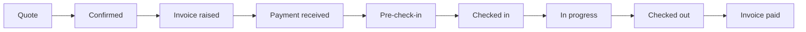

# Boarding and day care

The **Boarding & DayCare** page in the admin dashboard, and the **Boarding** tab in the staff app, run overnight stays and day care.

## Tabs (admin dashboard)

| Tab | What it's for |
| --- | --- |
| Dashboard | Today's AM, PM and overnight counts against capacity (4 per section), projected income this month, Arriving Today, Departing Today, Day Care Today, and upcoming bookings |
| Pre-Boarding | Eligibility questionnaires sent to new owners, with results and scores |
| Bookings | Current, Complete and Archive lists; open a booking for its detail page |
| Occupancy | A week or month grid of who's in each section, with a 24-hour timeline per day |
| Check In / Check Out | Every booking's scheduled and recorded drop-off and pick-up, who did it, and the form; export to PDF or email |
| Incident Reports | All incident reports across bookings |
| Risk Assessments, Policies, Checklists | See [Compliance and training](Compliance-and-Training) |

## A booking's lifecycle

Each booking gets a reference (format set in Settings > Boarding, for example `BK00015`) and moves through nine stages:

The status is worked out automatically from what's happened, and staff can override it from the booking detail page.

## The booking detail page

- **Booking Confirmation:** a branded PDF with the booking information and terms from Settings > Boarding; it can be emailed to the customer.
- **Amend dates** once the booking is invoiced; any unsent invoice is updated to match.
- **Invoice card:** totals, paid so far, balance, **Add payment**, **Request deposit**, **Request full payment**, or **Deposit not required**.
- **Forms:**
  - *Pre-check-in*: sent automatically a set number of days before drop-off, or with **Send now**.
  - *Check-in*: filled in by staff at drop-off; can require a photo and a signature.
  - *Check-out*: filled in at pick-up, with the check-in answers shown above; can require a signature.
- **Observations:** time-stamped notes by category, with up to 5 photos each.
- **Incident reports:** add, view as a branded PDF, edit, email to the customer.
- Once a booking is checked out and paid, it becomes read-only (except Delete).

## Pre-boarding questionnaire

Before a first stay, staff send an owner the pre-boarding form (**Pre-Boarding > New Form**: name, email, number of dogs). The owner answers one page per dog on the intake site. Answers are scored and the result is **Suitable** or **Not suitable**; some answers can fail a dog outright. The questions, sections, scores and follow-ups are edited in **Settings > Pre-Boarding**.

## Pricing

Day care and boarding prices come from the products mapped in **Settings > Bookings**: half day, full day, per day and the 2nd-dog rates.
