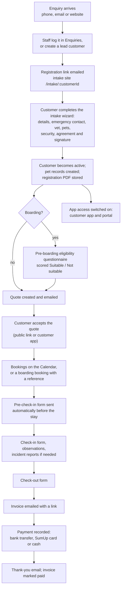

# Customer journey

This is the end-to-end path from first contact to a paid invoice, and which app each step happens in.

## Step by step

1. **Enquiry.** Staff log enquiries in the admin dashboard's **Enquiries** page. From an enquiry they can create a quote straight away, or **Convert to Customer**.
2. **Lead and registration link.** Converting an enquiry, or clicking **New customer** on the Customers page, creates a `pending` customer and emails a registration link (`/intake/<customerId>`). See [Public intake site](Public-Intake-Site).
3. **Intake.** The customer fills in the wizard on the intake site and signs the agreement. A PDF of the completed registration is stored against the customer and a copy is emailed to them.
4. **Active customer.** Staff review the record and set it to `active`. Staff can later send **Request Update** (status `update_info`) to have the customer re-check their details, or an **Add a pet** link.
5. **Pre-boarding (boarding only).** A pre-boarding questionnaire checks each dog's suitability before a first stay. See [Boarding and day care](Boarding-and-Day-Care).
6. **Quote and booking.** A quote is created and sent; once accepted, the stay or visits go on the calendar. Boarding and day care bookings get a booking reference and a booking confirmation PDF.
7. **The stay.** The pre-check-in form goes out automatically a set number of days before drop-off. Staff complete check-in and check-out forms in the admin dashboard or staff app, and record observations along the way.
8. **Invoice and payment.** Invoices are emailed with a public link and PDF. Payments are recorded against them (the staff app can take card payments with a SumUp reader), and a thank-you email can be sent.
9. **App access.** Staff can switch on app access for a customer from **Customer Defaults**. The customer then signs in to the [Customer app](Customer-App) or [Customer portal](Customer-Portal).

## Customer statuses

| Status | Meaning |
| --- | --- |
| `pending` | A lead: registration not completed yet |
| `active` | A current customer |
| `update_info` | Asked to re-check their details through a new intake link |
| `inactive` | No longer a customer; shown on the Inactive tab |
