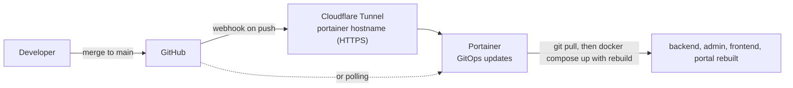

# Deployment with Portainer

Production runs as one Docker Compose stack in **Portainer**, built straight from this GitHub repository, with a **Cloudflare Tunnel** in front. A push to `main` redeploys automatically.

## The stack (`docker-compose.yml`)

| Service | What it is | Host port | Notes |
| --- | --- | --- | --- |
| `mongo` | MongoDB 7 | none | Data in the `mongo_data` volume; database `pawfectpets` |
| `backend` | NestJS API (Node 22, non-root, health check on `/health`) | 3000 | `TZ=Europe/London` so reminders and dates match UK time |
| `admin` | Admin dashboard (static build served by `serve`) | 8080 | Built with `VITE_API_URL` and `VITE_INTAKE_URL` |
| `frontend` | Public intake site | 8081 | Built with `VITE_API_URL` |
| `portal` | Customer portal | 8082 | Built with `VITE_API_URL` |
| `cloudflared` | Cloudflare Tunnel connector | none | Uses `CLOUDFLARE_TUNNEL_TOKEN` |

All services share the `pawfectpets` network. The app services use `pull_policy: build`, so a redeploy always rebuilds from the newly pulled code rather than reusing an old image.

## Stack environment variables

Set these on the stack in Portainer (Stacks > the stack > Editor > Environment variables). `.env.example` in the repo lists them.

| Variable | Used by | Notes |
| --- | --- | --- |
| `MONGO_ROOT_USERNAME`, `MONGO_ROOT_PASSWORD` | mongo, backend | Avoid `@ : / ? #` in the password; it goes into a connection URI |
| `ENCRYPTION_KEY` | backend | **Never change it once there's data.** It decrypts alarm codes and the Microsoft 365 client secret. |
| `JWT_SECRET` | backend | Changing it just signs everyone out |
| `PUBLIC_API_URL` | backend; admin, frontend and portal builds | e.g. `https://api.pawfectpetssherborne.co.uk`, no trailing slash |
| `PUBLIC_INTAKE_URL` | backend; admin build | e.g. `https://intake.pawfectpetssherborne.co.uk`; the base for links in emails |
| `ALLOWED_ORIGINS` | backend | Comma-separated: the admin, intake and portal URLs |
| `APNS_KEY`, `APNS_KEY_ID`, `APNS_TEAM_ID`, `APNS_BUNDLE_ID`, `APNS_CUSTOMER_BUNDLE_ID`, `APNS_PRODUCTION` | backend | Apple push; leave unset to turn push off |
| `CLOUDFLARE_TUNNEL_TOKEN` | cloudflared | From Cloudflare Zero Trust > Networks > Tunnels |

The `VITE_*` values are baked into the web apps when they're built, so after changing `PUBLIC_API_URL` or `PUBLIC_INTAKE_URL` you need a redeploy (which rebuilds).

## How a push reaches production

### Setting up automatic updates

1. In Portainer: **Stacks > the stack > Edit > GitOps updates**. Turn it on and choose **Webhook** (or Polling). Copy the webhook URL.
2. In GitHub: **Settings > Webhooks > Add webhook**. Paste the URL, content type `application/json`, "Just the push event".
3. In Cloudflare Zero Trust, the `portainer.pawfectpetssherborne.co.uk` public hostname must point at `https://<host>:9443` with the **HTTPS** service type. An HTTP route fails with `connection reset by peer`.

### Cloudflare Tunnel hostnames

In Zero Trust > Networks > Tunnels > the tunnel > **Public Hostnames**, map each hostname to the in-network service name:

| Hostname | Service |
| --- | --- |
| `api.…` | `http://backend:3000` |
| `admin.…` | `http://admin:80` |
| `intake.…` | `http://frontend:80` |
| `portal.…` | `http://portal:80` |

## Rolling back

`git revert` the unwanted commit on `main` and push. The next webhook or poll redeploys the previous code.

## Checking it's healthy

- Portainer > Containers shows each container's health.
- `https://api.pawfectpetssherborne.co.uk/health` returns `{"status":"ok"}`.
- Container logs are in Portainer > Containers > the container > **Logs**.

## No CI

There are no GitHub Actions for tests or builds (only the wiki publisher, see [Editing this wiki](Editing-This-Wiki)). Run lint, tests and builds locally before merging; see [Local development](Local-Development).

## Mobile apps

The two Flutter apps aren't deployed by the stack. They're built on a Mac and uploaded to App Store Connect; see [Versioning and releases](Versioning-and-Releases).

## History

The app used to run on Render (and Vercel). `render.yaml` is kept for reference only. The data was moved from MongoDB Atlas with `mongodump` / `mongorestore`; see the README's [Data migration](https://github.com/brownnetuk/PawfectPetsSherborne/blob/main/README.md#data-migration-atlas--self-hosted) section.
