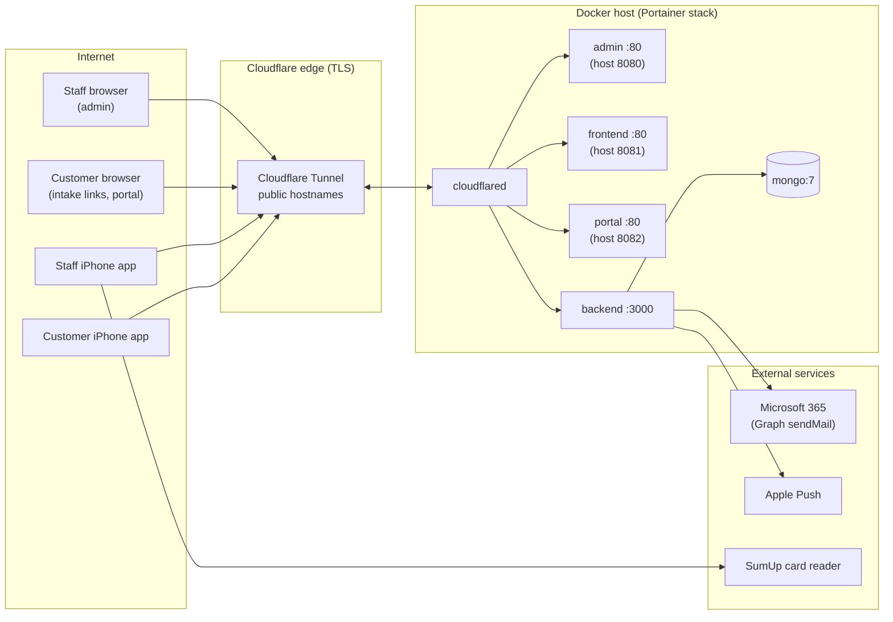
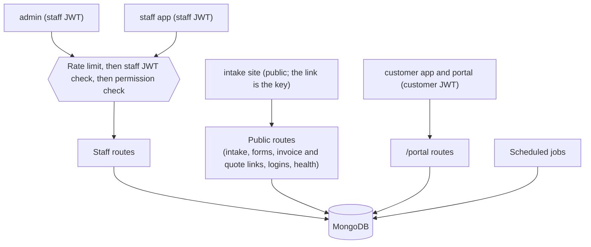

# System overview

PawfectPets Sherborne is one backend API with five client apps around it. Everything lives in one repository.

## The six apps

| Folder | App | Who uses it | Stack | Local dev URL |
| --- | --- | --- | --- | --- |
| `backend/` | [Backend API](Backend-API) | Every other app | NestJS 11, Mongoose 9, MongoDB 7, Passport JWT | `http://localhost:3000` |
| `admin/` | [Admin dashboard](Admin-Dashboard) | Staff, desktop browser | React 19, TypeScript, Vite | `http://localhost:5174` |
| `frontend/` | [Public intake site](Public-Intake-Site) | Customers, no login | React 19, TypeScript, Vite | `http://localhost:5173` |
| `portal/` | [Customer portal](Customer-Portal) | Customers, signed in, browser | React 19, TypeScript, Vite | `http://localhost:5175` |
| `mobile/` | [Staff app](Staff-App) | Staff in the field | Flutter (iOS first) | n/a |
| `mobile-portal/` | [Customer app](Customer-App) | Customers, signed in | Flutter (iOS only) | n/a |

## How it fits together



- The three web apps are static Vite builds served by `serve`. They call the API straight from the browser.
- Nothing on the Docker host needs an open port to the internet: `cloudflared` makes an outbound connection to Cloudflare, and Cloudflare routes each public hostname to a service on the internal Docker network.
- Email is sent through Microsoft 365 (Graph API), not SMTP.
- Push notifications go directly to Apple (APNs) from the backend, for both the staff app and the customer app.

## Who can call what



Staff and customers sign in to separate "realms" with different signing secrets, so a staff token never works as a customer token or the other way round. See [Staff accounts and permissions](Staff-Accounts-and-Permissions).

## Public hostnames

| Purpose | Hostname | Tunnel target |
| --- | --- | --- |
| API | `api.pawfectpetssherborne.co.uk` (`PUBLIC_API_URL`) | `http://backend:3000` |
| Admin dashboard | `admin.pawfectpetssherborne.co.uk` | `http://admin:80` |
| Public intake site | `intake.pawfectpetssherborne.co.uk` (`PUBLIC_INTAKE_URL`) | `http://frontend:80` |
| Customer portal | `portal.pawfectpetssherborne.co.uk` | `http://portal:80` |
| Portainer webhook | `portainer.pawfectpetssherborne.co.uk` | `https://<host>:9443` (HTTPS service type) |

The API health check is `GET /health`.

## Repository layout

```text
.
├── README.md             full technical reference
├── docker-compose.yml    production stack: mongo, backend, admin, frontend, portal, cloudflared
├── .env.example          stack environment variables for Portainer
├── render.yaml           retired Render blueprint, kept for reference
├── docs/                 security review, privacy policy, PDF samples, this wiki
├── backend/              NestJS API, one folder per domain under src/
├── admin/                React staff dashboard
├── frontend/             React public intake site
├── portal/               React customer portal
├── mobile/               Flutter staff app
└── mobile-portal/        Flutter customer app
```
