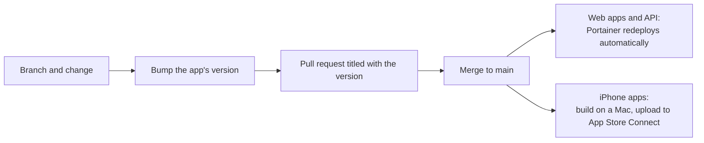

# Versioning and releases

Each app carries its own version number, and the user-facing apps are bumped with **every change that's pushed**, so you can always tell which build someone is looking at.

## Where each version lives

| App | File | Field | Where it shows | Version at time of writing |
| --- | --- | --- | --- | --- |
| Admin dashboard | `admin/package.json` | `version` | Top bar, e.g. `v1.0.199` | 1.0.199 |
| Customer portal | `portal/package.json` | `version` | Page footer and sign-in page | 1.0.3 |
| Staff app | `mobile/pubspec.yaml` | `version` | App Store Connect / TestFlight | 1.0.133 |
| Customer app | `mobile-portal/pubspec.yaml` | `version` (`name+build`) | App Store Connect / TestFlight | 1.1.6+25 |
| Backend | `backend/package.json` | `version` | Not shown; not bumped | 0.0.1 |
| Public intake site | `frontend/package.json` | `version` | Not shown; not bumped | 0.0.0 |

The admin dashboard and portal read the version from `package.json` at build time (`vite.config.ts` defines `__APP_VERSION__`).

## The rules

1. **Bump the patch number** (the last part) of each app you changed, in the same commit or pull request as the change. Admin `1.0.198` → `1.0.199`; staff app `1.0.132` → `1.0.133`.
2. **Customer app:** bump the version name and increase the build number after the `+`, e.g. `1.1.5+24` → `1.1.6+25`. App Store Connect needs a new build number for every upload.
3. **Backend and intake site** aren't versioned per release; their changes are tracked by commit and pull request.
4. **Name the version in the commit or pull request title**, e.g. `Admin 1.0.199: export the Check In / Check Out list to PDF or email`, or `Admin 1.0.198 / Staff app 1.0.128: ask before paying an already-paid invoice` when one change touches two apps.
5. Bump minor or major numbers only for a big change, e.g. the customer app's move to 1.1.x.

A new customer app version makes customers sign in again, because the app compares the stored version with the installed one.

## Release flow



### Web apps and backend

Merging to `main` is the release: Portainer pulls and rebuilds the stack. See [Deployment with Portainer](Deployment-with-Portainer). Check the version in the admin top bar or portal footer to confirm the new build is live (a hard refresh may be needed).

### iPhone apps

```bash
cd mobile            # or mobile-portal
flutter pub get
flutter build ipa --release --export-options-plist=ios/ExportOptions.plist
```

Then upload the `.ipa` from Xcode's Organizer or Transporter, and release it through TestFlight or the App Store. The export options let App Store Connect manage the build number for the staff app.

## Database changes

Some releases need a one-off data fix in production. These are written up as step-by-step Portainer instructions; see [Database maintenance](Database-Maintenance).
